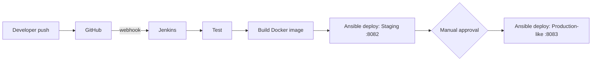

# simple-cicd

A simple CI/CD pipeline that delivers `index.html` automatically from GitHub to running containers.

## Architecture

## Branching
`feature/*` -> pull request -> `develop` -> pull request -> `main` (release, tagged `v1.0.0`).
Only pushes to `main` trigger the pipeline.

## Pipeline stages
1. Test: checks that `index.html` contains the greeting.
2. Build Image: `docker build` tagged `simple-cicd:<build number>`.
3. Deploy to Staging: `deploy.yml` starts the container on port 8082 and runs a health check.
4. Approval: a person clicks Proceed in Jenkins.
5. Deploy to Production-like: same image on port 8083.

## Runbook

**Normal release:** merge the PR into `main`, then click Proceed at Approval in Jenkins.

**Check status:**
    docker ps
    curl localhost:8082
    curl localhost:8083

**Rollback:** list images with `docker images | grep simple-cicd`, then deploy an older build:
    ansible-playbook deploy.yml -e version=<old build number>
    (add `-e container=simple-cicd-prod -e port=8083` for production-like)

**Failed release:** a failing Test stage stops the pipeline and nothing is deployed. Fix the code or run `git revert --no-edit HEAD` and push.
